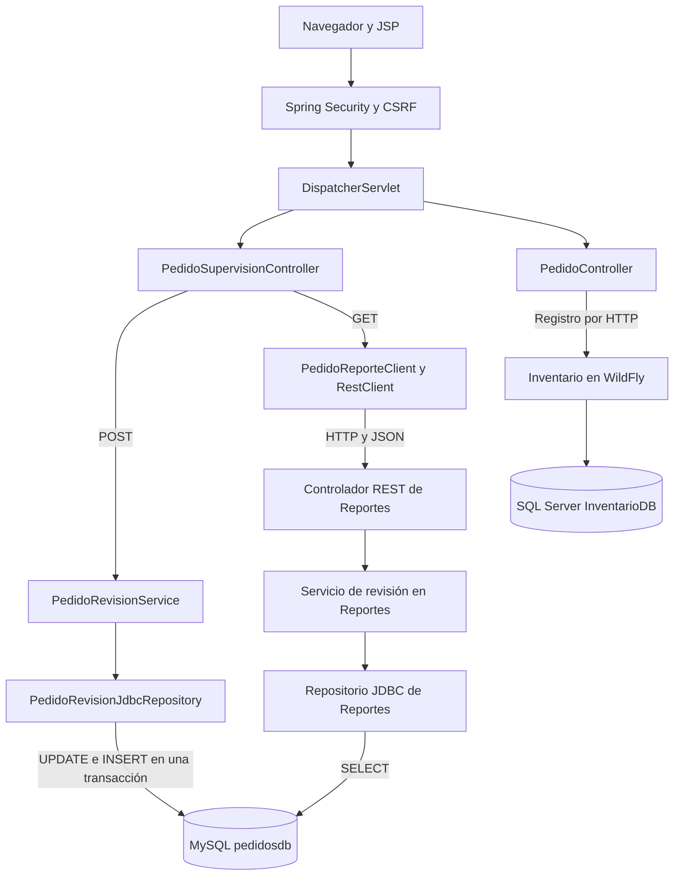

# Sistema de Pedidos PA4

Desarrollo de Aplicaciones Empresariales Avanzado · ISIL  
Diego Fernando Salva Puerta · Rama `feature/pa4-salva`

La PA4 incorpora un flujo de revisión de pedidos con trazabilidad. Una transacción local en MySQL cambia el estado del pedido y registra su observación y fecha. Supervisión usa Spring MVC y JSP para presentar el listado y las estadísticas obtenidos del servicio de Reportes.

## Módulos y requisitos

| Módulo | Carpeta dentro de `ADVANCED-BUSINESS-APPLICATION-DEVELOPMENT` | Puerto | Persistencia |
|---|---|---:|---|
| Inventario | `Sesión 4/inventario-service` | 8082 | SQL Server Express |
| Pedidos | `Sesión 5/sistema-pedidos-springboot` | 8081 | MySQL, esquema `pedidosdb` |
| Reportes | `Sesión 12/pedidos-reportes-service` | 8083 | El mismo esquema `pedidosdb` |

Requisitos: Java 21, Maven, MySQL 8 y SQL Server Express con TCP/IP local habilitado en el puerto 1433. El plugin Maven de Inventario aprovisiona WildFly 41.

## Arquitectura



## Preparación y arranque

1. **Inventario.** En SQL Server, ejecutar `database/01_crear_inventario.sql` desde el módulo de la sesión 4. Seguir el [README de Inventario](ADVANCED-BUSINESS-APPLICATION-DEVELOPMENT/Sesi%C3%B3n%204/inventario-service/README.md) para la configuración local del datasource. Desde ese módulo, ejecutar `mvn clean wildfly:run` y comprobar que [la API de productos](http://localhost:8082/inventario-service/api/inventario/productos) responde.
2. **Pedidos.** Crear el esquema MySQL con `CREATE DATABASE IF NOT EXISTS pedidosdb CHARACTER SET utf8mb4;`. Configurar las variables indicadas abajo y, desde el módulo de la sesión 5, ejecutar `mvn spring-boot:run`. En una instalación nueva, Hibernate crea la tabla `pedido` al iniciar.
3. **Esquema PA4.** Cuando exista `pedido`, ejecutar [pa4_revision_pedido.sql](ADVANCED-BUSINESS-APPLICATION-DEVELOPMENT/Sesi%C3%B3n%205/sistema-pedidos-springboot/database/pa4_revision_pedido.sql) en MySQL. Aplicar el script una vez por esquema. La columna `pedido.revisado` se inicia en `false`. La tabla `pedido_revision` almacena la observación y la fecha, usa una clave foránea a `pedido` y una restricción única sobre `pedido_id`.
4. **Reportes.** En otra terminal, configurar las mismas variables de conexión a MySQL. Desde el módulo de la sesión 12, ejecutar `mvn spring-boot:run`. Abrir [Pedidos](http://localhost:8081/sistema-pedidos/pedidos) para registrar un pedido y [Supervisión](http://localhost:8081/sistema-pedidos/supervision/pedidos) para revisarlo.

### Variables de entorno y usuarios de laboratorio

| Variable | Módulo | Valor |
|---|---|---|
| `DB_URL` | Pedidos y Reportes | `jdbc:mysql://127.0.0.1:3306/pedidosdb` |
| `DB_USERNAME` | Pedidos y Reportes | Usuario local de MySQL |
| `DB_PASSWORD` | Pedidos y Reportes | Contraseña local de MySQL |
| `PEDIDOS_OPERADOR_PASSWORD` | Pedidos | Contraseña de laboratorio para `operador` |
| `PEDIDOS_CONSULTA_PASSWORD` | Pedidos | Contraseña de laboratorio para `consulta` |

`operador` tiene el rol `OPERADOR` y puede registrar y revisar pedidos. `consulta` tiene el rol `CONSULTA` y puede consultar la supervisión. El formulario de revisión envía el token CSRF de la sesión. Configurar las contraseñas localmente.

## Rutas PA4

| Aplicación | Método y ruta | Comportamiento |
|---|---|---|
| Pedidos | `GET /sistema-pedidos/supervision/pedidos?estado=REVISADO` | Muestra la JSP. El estado por defecto es `PENDIENTE`. Si Reportes está caído, devuelve HTTP 503 y muestra un aviso. |
| Pedidos | `POST /sistema-pedidos/supervision/pedidos/{id}/revisar` | Recibe `observacion`. Si guarda, redirige al listado de revisados. Los errores de negocio redirigen con un mensaje. |
| Reportes | `GET /pedidos-reportes-service/api/v1/pedidos/revisiones?estado=REVISADO` | Devuelve un listado JSON para `PENDIENTE` o `REVISADO`. Un valor inválido devuelve HTTP 400. |
| Reportes | `GET /pedidos-reportes-service/api/v1/pedidos/estadisticas/revisiones` | Devuelve los totales y el porcentaje de revisión en JSON. |

Ejemplo de listado revisado:

```json
[
  {
    "id": 1,
    "cliente": "Prueba-PA4",
    "productoCodigo": "LAP-001",
    "productoNombre": "Laptop",
    "total": 2500.00,
    "estado": "REVISADO",
    "observacion": "Datos del pedido verificados",
    "fechaRevision": "2026-11-24T12:44:02.094903"
  }
]
```

Ejemplo de estadísticas:

```json
{"totalPedidos":3,"totalRevisados":2,"totalPendientes":1,"porcentajeRevisado":66.67}
```

## Pruebas

Ejecutar `mvn test` en Pedidos y en Reportes. Los últimos resultados documentados de las suites completas fueron **31 pruebas aprobadas en Pedidos** y **16 en Reportes**, con cero fallos, errores u omisiones.

| Bloque PA4 | Pruebas nuevas | Cobertura |
|---|---:|---|
| Servicio de revisión | 5 | Commit, rollback tras error de inserción, revisión duplicada, ID inexistente y entradas inválidas |
| Cliente HTTP | 5 | Lectura de listado y estadísticas, HTTP 503, conexión rechazada y timeout |
| Supervisión MVC | 7 | Modelo de la vista, redirección, roles, CSRF y los tres mensajes de validación |
| Contrato REST de Reportes | 4 | Listados pendiente y revisado, estadísticas y filtro inválido |

Los cinco casos prácticos cubren una revisión correcta, una segunda revisión rechazada, validaciones, rollback en H2 y el comportamiento de Supervisión con Reportes disponible o detenido.

## Limitaciones del laboratorio

- La revisión admite una observación y un registro de trazabilidad por pedido.
- Pedidos y Reportes comparten el esquema MySQL. El listado y las estadísticas de Supervisión dependen de Reportes.
- El rollback forzado se reproduce en H2. El guardado y la conservación de las revisiones se verificaron también en MySQL.
- El entorno está configurado para ejecutar los tres módulos localmente.
